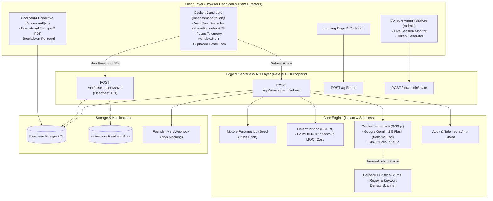
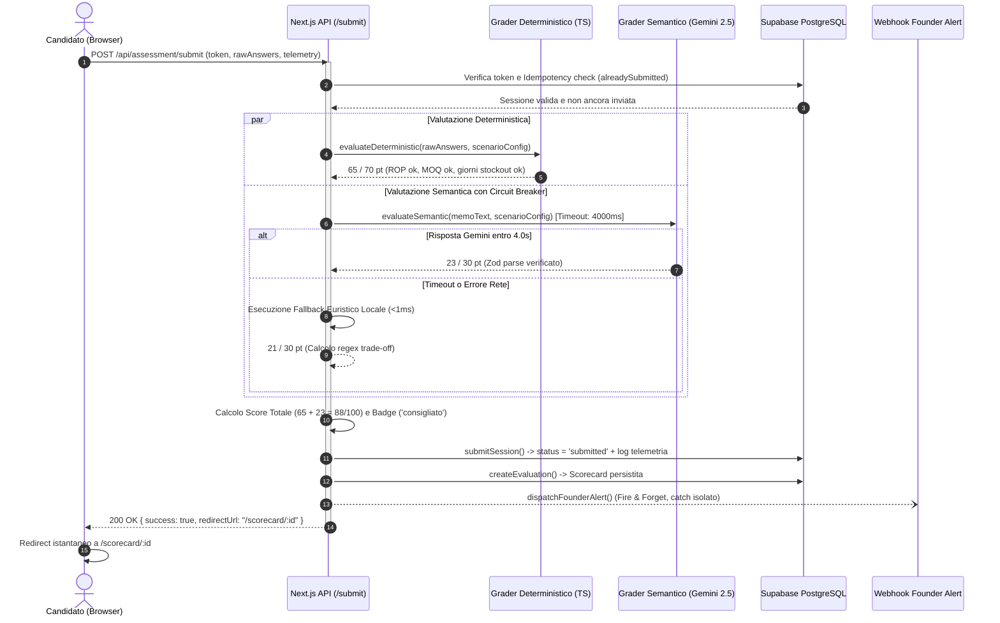

# SkillBridge — Architectural Blueprint & Tech Lead Engineering Review

**Data del Documento:** 28 Ottobre 2026  
**Autore:** Head of Engineering / Technical Architect  
**Stato del Sistema:** Live in Produzione (`skillbridge-mocha-three.vercel.app`)  
**Stack Principale:** Next.js 16 (App Router + Turbopack), TypeScript 5 (Strict), Tailwind CSS v4, Supabase (PostgreSQL), Google Gemini 2.5 Flash, Vitest.

---

## 1. Topologia di Sistema & Diagramma Architetturale

L'architettura di SkillBridge è progettata secondo il paradigma **Serverless ad Alto Rendimento** con separazione rigida tra:
- **Presentation Layer:** Componenti React 19 Server e Client Component ottimizzati per Web Vitals e accessibilità.
- **Evaluation & Security Engine:** Pipeline di grading ibrido isolata (deterministico sub-millisecondo + semantico LLM con circuit breaker).
- **Data & Persistence Layer:** Supabase PostgreSQL con fallback automatico su memoria volatile per scenari offline/dev.

---

## 2. Sequenza di Esecuzione & Pipeline di Valutazione (End-to-End)

---

## 3. Pattern di Resilienza, Circuit Breakers & Tolleranza ai Guasti

1. **LLM Circuit Breaker (Timeout 4.0s):** Se Gemini 2.5 Flash subisce picchi di latenza o è offline, scatta `evaluateHeuristicFallback()` locale in <1ms. Nessun errore 500 per l'utente finale.
2. **Idempotency Guard & Timer Server-Side:** Submit protetto da doppie invocazioni accidentali; timer calcolato su timestamp di database (tolleranza 60s per ritardi di rete).
3. **Heartbeat Auto-Save (15s):** Sincronizzazione continua su `localStorage` e via API asincrona per evitare perdite dati in caso di crash o refresh.
4. **Webhook Non-Bloccante:** Invio asincrono con `Promise.catch()` isolato senza bloccare il redirect del candidato.

---

## 4. Test Suite & Qualità del Software

- **TypeScript:** 0 errori in Strict Mode (`npx tsc --noEmit`).
- **Vitest:** **56/56 test passati** su 8 suite (determinismo, anti-cheat, webhook, timeout LLM, lead, runner).
- **Build Next.js 16:** 25 rotte prerenderizzate staticamente in 22 secondi.
