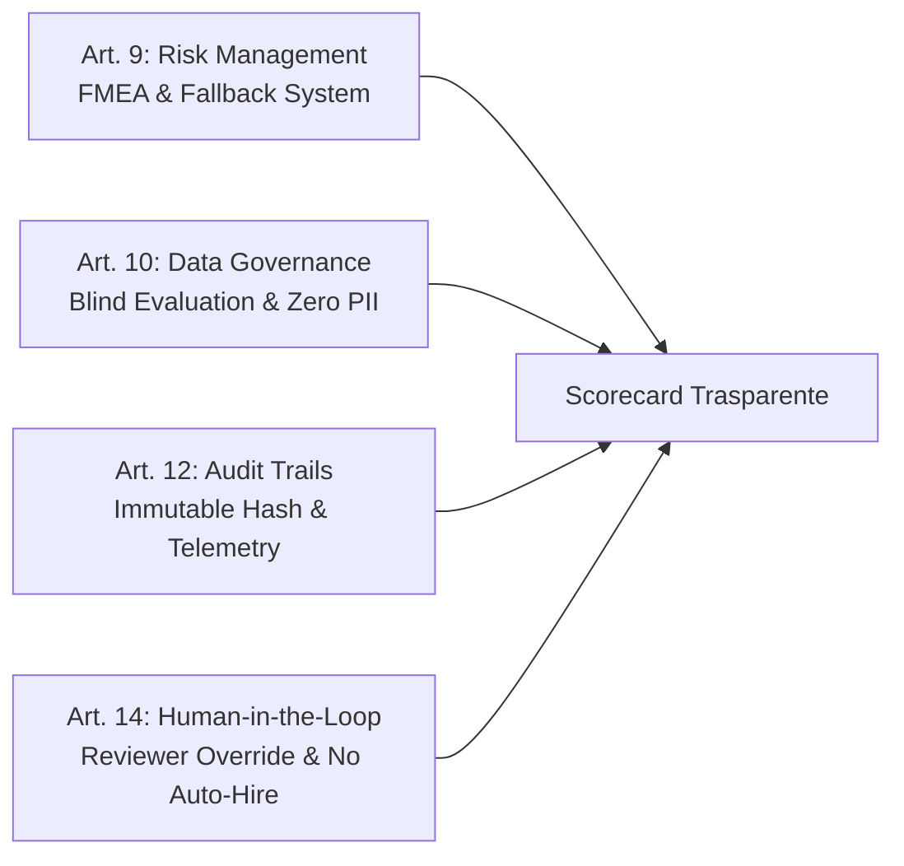

# SkillBridge — Manuale di Conformità & QMS (Quality Management System)
**Documento Ufficiale:** SB-QMS-DOC-2026-V1  
**Data:** 28 Ottobre 2026  
**Quadro Normativo:** Regolamento UE 2024/1689 (EU AI Act), Regolamento UE 2016/679 (GDPR), Standard ISO 9001:2015, ISO/IEC 42001:2023 (AI Management System)  
**Applicabilità:** Piattaforma SaaS di Assessment Tecnico e Selezione Ingegneri Gestionali  

---

## 1. Conformità EU AI Act (Regolamento UE 2024/1689)

### 1.1 Classificazione del Sistema di IA
SkillBridge rientra nella categoria dei **Sistemi di IA ad Alto Rischio** ai sensi dell'**Allegato III, Punto 4** del Regolamento UE sull'Intelligenza Artificiale (*"Occupazione, gestione dei lavoratori e accesso al lavoro autonomo: sistemi di IA destinati a essere utilizzati per l'assunzione o la selezione di persone fisiche"*).

In conformità ai requisiti stringenti del Capo III del Regolamento, SkillBridge applica l'architettura tecnica e i presidi descritti di seguito.

---

### 1.2 Matrice di Conformità ai Requisiti di Alto Rischio

#### Articolo 9 — Sistema di Gestione dei Rischi
SkillBridge implementa un processo iterativo di gestione del rischio basato su metodologia FMEA (Failure Mode and Effects Analysis):
1. **Rischio Allucinazione LLM nel Grading Semantico:** Mitigato circoscrivendo il ruolo dell'LLM (Gemini 2.5 Flash) a un massimo di 30 punti su 100 con rubrica a criteri chiusi (1–5) e vincolo di risposta su schema JSON tipizzato. In caso di timeout (>4.000 ms) o schema non valido, il sistema attiva automaticamente un analizzatore euristico a parole chiave industriali.
2. **Rischio Falsi Positivi Anti-Cheat:** Gli eventi telemetrici (blur finestra, paste, webcam) non determinano mai la bocciatura automatica del candidato, ma vengono registrati come "Indicatori di Integrità" a supporto della verifica umana.
3. **Rischio Indisponibilità o Drift Parametrico:** I parametri industriali dei 20 scenari sono deterministici e generati con hashing a 32-bit (FNV-1a) a partire dal token univoco, rendendo ogni test riproducibile e non manipolabile.

#### Articolo 10 — Governance dei Dati e Mitigazione dei Bias (Blind Evaluation)
1. **Neutralità Demografica Assoluta:** Il motore di valutazione semantica riceve **esclusivamente** il testo della memoria decisionale e i parametri tecnici dello scenario. Dati anagrafici, genere, età, provenienza geografica, ateneo di provenienza e foto del candidato vengono completamente espunti dal payload di valutazione (Valutazione Cieca).
2. **Dataset di Ground Truth Convalidati:** Ciascuno dei 20 scenari è calibrato su dati ingegneristici reali di impianti manifatturieri dell'area industriale italiana (Brescia, Bergamo, Modena, Bologna, Vicenza, Treviso), con costi orari di fermo linea e tempi di riordino coerenti con la prassi operativa del settore metalmeccanico e meccatronico.

#### Articolo 11 — Documentazione Tecnica e Spiegabilità
La documentazione tecnica di calcolo (formule di stockout, giorni di fermo, calcolo lotti minimi e costo extra) è pubblica, deterministica e verificabile. La scorecard di sintesi dettaglia il punteggio ottenuto su ciascun parametro con trasparenza totale.

#### Articolo 12 — Registrazione Automatica degli Eventi (Audit Trail)
La piattaforma registra in modo immutabile nel database Supabase:
- Timestamp di avvio, salvataggi intermedi e invio definitivo.
- Risposte numeriche e testuali esatte del candidato.
- Fotogramma compresso catturato via webcam durante la sessione.
- Conteggio esatto di blur finestra, tentativi di copia/incolla e aperture devtools.
- Traccia completa dell'eventuale override applicato dal revisore umano, inclusa motivazione e timestamp.

#### Articolo 13 — Trasparenza e Istruzioni per l'Uso
Ogni Plant Director o HR Manager riceve una Scorecard A4 strutturata in 5 sezioni che spiega esplicitamente:
- Punteggio quantitativo deterministico (0–70 pt).
- Valutazione semantica con rubric dettagliata (0–30 pt).
- Indice di integrità e conformità proctoring.
- Raccomandazione sintetica non vincolante (*Consigliato*, *Riserva*, *Non Idoneo*).

#### Articolo 14 — Sorveglianza Umana (Human-in-the-Loop)
> **PRINCIPIO FONDAMENTALE:** SkillBridge **non adotta alcuna decisione automatizzata vincolante di assunzione o rigetto**. La scorecard funge da strumento istruttorio a supporto del giudizio umano.
- La decisione finale di colloquiare o assumere un candidato spetta esclusivamente all'Azienda Cliente.
- È implementata una funzione di override umano (`/api/admin/override`) protetta da autenticazione con cui l'ingegnere supervisore può rivalutare le risposte o annullare anomalie di rete.

#### Articolo 15 — Accuratezza, Robustezza e Sicurezza
- Architettura ridondata su infrastruttura Next.js App Router e Vercel Edge.
- Rate Limiting a finestra scorrevole su tutti gli endpoint pubblici.
- 10 suite di test con 65 verifiche automatiche continue in CI/CD.

---

## 2. Conformità GDPR (Regolamento UE 2016/679)

### 2.1 Basi Giuridiche del Trattamento
- **Esecuzione di Misure Precontrattuali (Art. 6.1.b GDPR):** Trattamento dei dati di contatto (nome, email) e delle risposte tecniche per finalità di selezione del personale su richiesta o accettazione del candidato.
- **Consenso Esplicito (Art. 6.1.a e Art. 9.2.a GDPR):** Acquisito nella schermata iniziale di briefing prima dell'attivazione della webcam e della registrazione del fotogramma di presenza.

### 2.2 Trattamento dei Flussi Video e Anti-Cheat
1. **Nessun Trattamento Biometrico Identificativo:** La piattaforma **non effettua riconoscimento facciale**, mappatura biometrica delle caratteristiche fisiologiche o sentiment analysis.
2. **Fotogramma di Verifica:** Viene acquisito un unico fotogramma a bassa risoluzione (320x240 JPEG) avente il solo scopo di attestare la presenza del candidato alla postazione durante l'esecuzione della simulazione.
3. **Elaborazione Locale:** Il flusso video della webcam è gestito interamente in locale nel browser del candidato (`getUserMedia`) e non viene trasmesso in streaming continuo a server terzi.

### 2.3 Periodo di Conservazione (Data Retention) & Purge Automatico
- **Dati di Telemetria e Fotogramma Webcam:** Conservati per un massimo di **90 giorni** dal completamento della simulazione, dopodiché vengono cancellati automaticamente in modo irreversibile.
- **Scorecard e Valutazione Tecnica:** Conservate per **180 giorni** a garanzia del periodo contrattuale di replacement per l'Azienda Cliente, trascorso il quale vengono anonimizzate per scopi puramente statistici.

### 2.4 Salvaguardie ex Articolo 22 GDPR (Processo Decisionale Automatizzato)
In conformità all'Art. 22, par. 3 del GDPR, il candidato ha il diritto di:
1. Conoscere la logica di funzionamento del sistema di simulazione.
2. Richiedere una revisione umana della propria prova contattando il supporto (`supporto@skillbridge.it`).
3. Esprimere la propria opinione o contestare una segnalazione di anomalia telemetrica.

### 2.5 Modello Data Processing Addendum (DPA)
Nei rapporti con le aziende clienti:
- **Azienda Cliente:** Titolare del Trattamento (Data Controller).
- **SkillBridge:** Responsabile del Trattamento (Data Processor), conformemente all'Art. 28 GDPR.

---

## 3. Sistema di Gestione della Qualità (QMS — ISO 9001 / ISO/IEC 42001)

### 3.1 Politica della Qualità e Obiettivi Misurabili
SkillBridge si impegna a fornire alle aziende del settore manifatturiero una valutazione delle competenze ingegneristiche oggettiva, replicabile e tempestiva.

| Obiettivo Qualità | KPI di Riferimento | Target | Monitoraggio |
| :--- | :--- | :---: | :--- |
| **Accuratezza Deterministica** | Tasso di errore nelle formule di scenario | 0.0% | Test automatici su CI/CD ad ogni build |
| **Tempestività di Consegna** | Generazione Scorecard dal submit candidato | < 5 secondi | Tracciamento latenza API |
| **SLA Commerciale Pilota** | Presentazione 3 profili qualificati | ≤ 7 giorni | Reportistica operativa settimanale |
| **Allineamento Human-AI** | Concordanza valutativa revisore/sistema | ≥ 92.0% | Campionamento mensile 20% scorecard |
| **Contenimento Falsi Positivi** | Segnalazioni anti-cheat ingiustificate | < 1.0% | Audit log telemetrici |
| **Uptime del Servizio** | Disponibilità API e Cockpit | ≥ 99.9% | Monitoring Vercel & Supabase |

---

### 3.2 Procedure Operative Standard (SOP)

#### SOP-01: Progettazione e Rilascio di Nuovi Scenari Industriali
1. **Definizione Requisiti:** L'ingegnere industriale senior formula il problema tecnico (es. blocco fornitura, guasto critico) basandosi su standard industriali (MRP, Lean, Six Sigma, APQP).
2. **Validazione Parametrica:** Implementazione delle formule in `parametric.ts` verificando che ogni combinazione di parametri rispetti i vincoli fisici ed economici di stabilimento.
3. **Automazione QA:** Inserimento dello scenario nella suite di test automatizzati per confermare che il ground-truth consegua esattamente 70/70 punti deterministici su 5 seed randomici.
4. **Approvazione:** Firma congiunta del Responsabile Tecnico e del Lead Industrial Engineer prima del rilascio nel catalogo di produzione.

#### SOP-02: Calibrazione Periodica della Rubrica Semantica
1. **Verifica Mensile dei Prompt:** Revisione dei pesi (Tradeoff Costi, Consapevolezza Rischi, Sintesi Decisionale) per prevenire derive nella distribuzione dei voti.
2. **Test di Robustezza:** Esecuzione di test ciechi con risposte modello eccellenti, mediocri e scarse, convalidando il matching rispetto ai voti assegnati dal comitato tecnico umano.
3. **Controllo Fallback:** Verifica del funzionamento dell'euristica di backup in caso di indisponibilità dell'endpoint LLM.

#### SOP-03: Gestione delle Anomalie di Proctoring e Contestazioni
1. **Trigger di Revisione:** Una sessione con più di 3 blur finestra, tentativi di copia bloccati o fotogramma non conforme viene contrassegnata per audit umano obbligatorio.
2. **Istruttoria:** Il Quality Specialist esamina l'audit log telemetrico e il fotogramma di verifica.
3. **Intervista Tecnica Integrativa:** Qualora sussista un dubbio legittimo (es. disconnessione di linea o problema del browser), al candidato viene concesso un colloquio chiarificatore di 10 minuti o una re-sessione con seed differente.
4. **Chiusura Fascicolo:** Registrazione formale dell'esito nell'archivio di audit.

#### SOP-04: Audit Trimestrale e Miglioramento Continuo
1. **Analisi Statistica:** Elaborazione trimestrale della deviazione standard dei punteggi, del tasso di assunzione post-scorecard e dei feedback dei Plant Director clienti.
2. **Risoluzione Non Conformità:** Qualora un quesito o uno scenario presenti un tasso di errore anomalo (>80% di risposte errate da candidati qualificati), viene avviata una CAPA (Corrective and Preventive Action) per revisionare la chiarezza del testo dello scenario.

#### SOP-05: Gestione della Garanzia di Sostituzione a 180 Giorni
1. **Notifica di Sostituzione:** Ricezione da parte dell'azienda cliente della notifica di interruzione del rapporto con il neoassunto entro i 180 giorni solari dall'assunzione.
2. **Avvio Immediato Ricerca Sostitutiva:** Attivazione prioritaria del pool di candidati già valutati nella medesima categoria geografica e professionale.
3. **Presentazione 3 Profili:** Erogazione di 3 nuove scorecard complete entro 7 giorni lavorativi a costo zero per il cliente.
