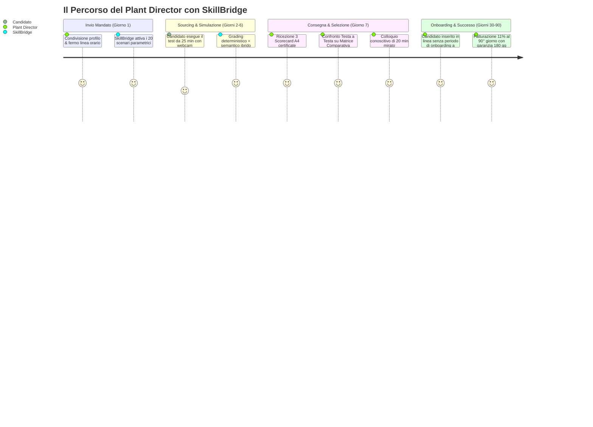
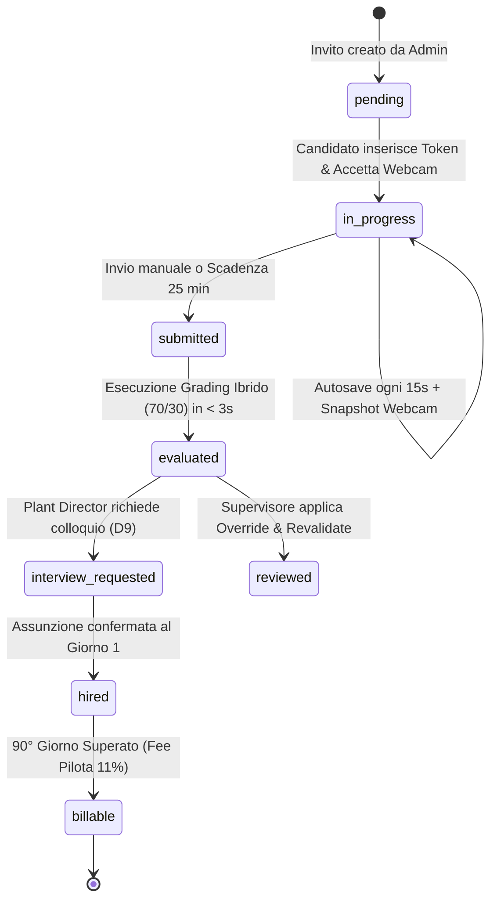

# SkillBridge — Product & Architecture Roadmap
**Documento Ufficiale:** SB-PRD-ARCH-2026-V1  
**Data:** 28 Ottobre 2026  
**Ruolo:** Product Management & Lead Architecture  
**Stato Operativo:** Produzione Attiva ([skillbridge-mocha-three.vercel.app](https://skillbridge-mocha-three.vercel.app))  

---

## 1. Visione di Prodotto & Strategia di Valore

SkillBridge trasforma il recruitment ingegneristico per l'industria manifatturiera italiana eliminando l'asimmetria informativa dei CV cartacei mediante **simulazioni operative da 25 minuti su scenari reali di fabbrica**.

### La Promessa di Prodotto al Plant Director
> *"Entro 7 giorni lavorativi consegniamo al Direttore di Stabilimento 3 ingegneri gestionali pre-valutati su guasti e blocchi di linea reali, corredati da Scorecard A4 e fotogramma proctoring certificato. Zero anticipi: la fee pilota dell'11% si paga solo al 90° giorno a prova superata."*



---

## 2. Product Requirements Document (PRD) — Le 4 Epic Fondamentali

### Epic-01: Candidate Simulator Ergonomics & Scenario Engine
* **Obiettivo:** Offrire un'esperienza di valutazione fluida in 25 minuti, azzerando le frizioni di login e garantendo la massima concentrazione sotto pressione.
* **User Story 1.1 (Accesso Zero-Friction):** Come candidato, accedo alla simulazione inserendo un token o cliccando un magic link, senza creare credenziali complesse.
* **User Story 1.2 (Autosave Asincrono Resiliente):** Come candidato, se il mio browser si disconnette per 5 secondi, le mie risposte parziali rimangono salvate in background ogni 15 secondi senza perdere i calcoli.
* **User Story 1.3 (Sottomissione Forzata a Scadenza):** Al termine dei 25 minuti, il sistema esegue automaticamente la consegna crittografata con salvataggio dello stato corrente.

### Epic-02: Executive Comparison Matrix & Decision Cockpit *(IMPLEMENTATO)*
* **Obiettivo:** Permettere al Plant Director e all'HR Manager di confrontare i 3 profili finalisti affiancati testa a testa su un'unica schermata.
* **User Story 2.1 (Selezione Multipla in Admin):** Come Plant Director, seleziono da 2 a 3 candidati dalla pipeline e attivo la schermata comparativa con un clic.
* **User Story 2.2 (Matrice Parametrica Normalizzata):** Come Plant Director, visualizzo affiancati: punteggio complessivo, calcolo del giorno di stockout, costo di fermo linea risparmiato, quantità riordinata, tempo di esecuzione e anomalie telemetriche.
* **User Story 2.3 (Memorie Decisionali Affiancate):** Come Plant Director, leggo in colonne parallele l'Executive Memo scritta da ciascun candidato per valutarne la sintesi e la visione economica.
* **User Story 2.4 (Esportazione Batch CSV):** Come HR, posso scaricare l'intera lista candidati in CSV per condivisione con il comitato retribuzioni.

### Epic-03: Proctoring Integrity & Anti-Cheat Shield *(IMPLEMENTATO)*
* **Obiettivo:** Garantire l'integrità del test e scongiurare l'uso di AI generative esterne, secondi schermi o aiuti non autorizzati.
* **User Story 3.1 (Fotogramma Webcam Compresso):** Il sistema cattura un fotogramma JPEG (320x240) della webcam ad ogni salvataggio/invio, certificando la presenza del candidato.
* **User Story 3.2 (Inibizione Copia/Incolla):** La combinazione `Ctrl+V` e il menu contestuale sono inibiti per impedire l'inserimento di prompt generati altrove.
* **User Story 3.3 (Tracciamento Focus/Blur):** Il sistema registra il numero di uscite dalla scheda (`window.blur`) annotandole nella scorecard per la verifica del revisore.

### Epic-04: Enterprise Pilot Contract & 90-Day Placement Tracking
* **Obiettivo:** Monitorare il periodo di prova di 90 giorni e coordinare l'eventuale sostituzione gratuita a 180 giorni.
* **User Story 4.1 (Milestone Check-in):** Invio automatico di notifiche di follow-up al Day 30, Day 60 e Day 90 per verificare la soddisfazione del Plant Director.
* **User Story 4.2 (Attivazione Sostituzione):** In caso di dimissioni del candidato entro 180 giorni, attivazione prioritaria di 3 nuovi profili entro 7 giorni senza costi aggiuntivi.

---

## 3. Architettura Tecnica & Blueprint del Lead Engineer

### 3.1 C4 Diagram — Container Architecture

```mermaid
flowchart TD
    subgraph Client Tier
        BROWSER["Web Browser Candidato / Plant Director<br><i>(Next.js 16 App Router / Tailwind CSS)</i>"]
    end

    subgraph Edge CDN & Routing Tier (Vercel)
        EDGE["Edge Middleware & CDN<br><i>(Sliding-Window Rate Limiter & Edge Cache)</i>"]
    end

    subgraph Serverless API & Core Domain (Next.js)
        API_SCORECARD["/api/scorecard/[id]<br><i>(Cache-Control: s-maxage=300)</i>"]
        API_ASSESS["/api/assessment/*<br><i>(Start, Save, Submit, Rate Limiter)</i>"]
        API_ADMIN["/api/admin/*<br><i>(Override, Revalidate, Comparison Exporter)</i>"]
        
        subgraph Hybrid Grading Engine
            DET_ENGINE["Deterministic Grader (T2)<br><i>(Stockout, Downtime, Lot Sizing - Max 70 pt)</i>"]
            SEM_ENGINE["Hybrid Semantic Grader (T3)<br><i>(Gemini 2.5 Flash + 4.0s Fallback - Max 30 pt)</i>"]
        end
    end

    subgraph Persistence & Audit Tier
        DB["Supabase PostgreSQL<br><i>(assessment_sessions, evaluations, leads)</i>"]
        MEM_STORE["In-Memory Mock Fallback<br><i>(Zero-dependency local & test mode)</i>"]
    end

    BROWSER -->|HTTPS / TLS 1.3| EDGE
    EDGE --> API_SCORECARD
    EDGE --> API_ASSESS
    EDGE --> API_ADMIN

    API_ASSESS --> DET_ENGINE
    API_ASSESS --> SEM_ENGINE
    DET_ENGINE --> DB
    SEM_ENGINE --> DB

    API_ADMIN --> DB
    API_SCORECARD --> DB
```

### 3.2 Macchina a Stati della Sessione Candidato



---

## 4. Nuove Funzionalità Rilasciate in questo Sprint

1. **Matrice Comparativa Testa a Testa (`/admin/confronta`):**
   * Schermata dedicata in visual identity Linear/Stripe.
   * Confronto contemporaneo di 2 o 3 candidati selezionati dall'Admin Cockpit.
   * Tabella parametrica normalizzata (Score complessivo, costo fermo linea evitato, scostamento lotti, tempo di esecuzione, uscite dalla finestra).
   * Visualizzazione affiancata delle Executive Memo scritte dai candidati per il Plant Director.
   * Azione diretta "Richiedi Colloquio" e visualizzazione snapshot webcam con badge di conformità.
2. **Esportazione Candidati Batch in Formato CSV ([`src/lib/assessment/comparison.ts`](file:///c:/Users/leona/Desktop/SkillBridge/src/lib/assessment/comparison.ts)):**
   * Esportazione conforme RFC di tutti i campi quantitativi e qualitativi dei candidati per facilitare i comitati di selezione aziendali.
3. **Barra di Azione Galleggiante in Admin Cockpit ([`src/app/admin/page.tsx`](file:///c:/Users/leona/Desktop/SkillBridge/src/app/admin/page.tsx)):**
   * Selezione rapida con checkbox su ogni riga della pipeline.
   * Barra contestuale con conteggio dinamico e link immediato al confronto.
4. **Nuova Suite di Test Comparativa ([`src/lib/assessment/__tests__/comparison.test.ts`](file:///c:/Users/leona/Desktop/SkillBridge/src/lib/assessment/__tests__/comparison.test.ts)):**
   * 3 test unitari dedicati alla validazione della matrice e dell'esportatore CSV, portando la suite totale a **68 test passati**.
