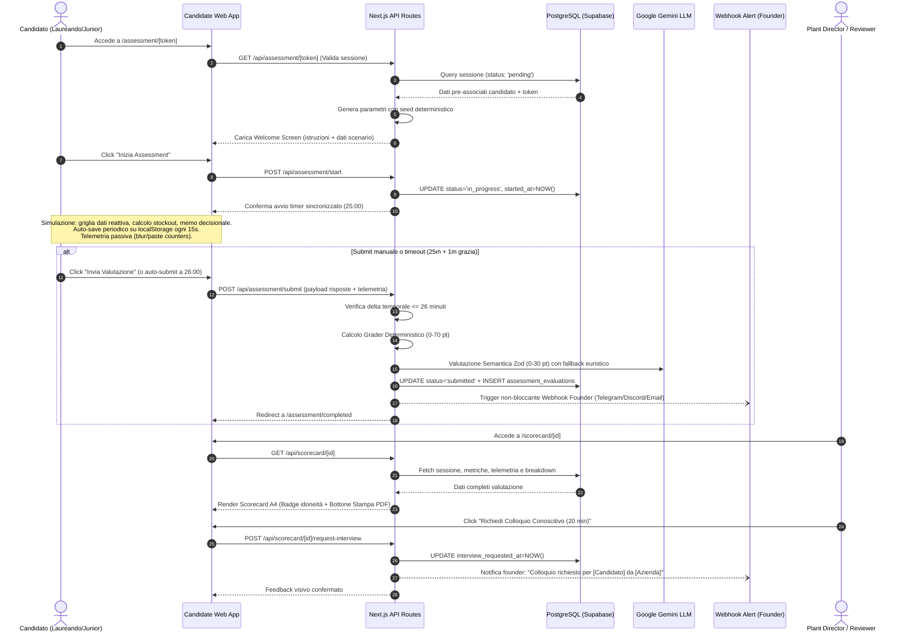

# [SPEC] SkillBridge MVP: Vertical Slice Assessment Engine per Supply Chain Specialist (Scenario Valvola V-104)

**Status:** APPROVED FOR IMPLEMENTATION (Revised & Certified by `/plan-ceo-review`)  
**Branch:** master  
**Author:** Antigravity (via `/spec` & `/plan-ceo-review`)  
**Review Mode:** SELECTIVE EXPANSION (All 4 expansions accepted)  
**Date:** 2026-10-23  

---

## 1. Context & Motivation
Il recruiting tradizionale per figure operative e gestionali (Supply Chain Specialist, Production Planner, Operations Analyst) è bloccato da una severa asimmetria informativa: i candidati dimostrano padronanza teorica ("Lean", "Kanban"), ma le aziende manifatturiere registrano elevati tassi di errore di assunzione perché i colloqui tradizionali non valutano la reattività decisionale sotto vincoli operativi reali.

Questa specifica definisce il **vertical slice completo dell'MVP di SkillBridge**: una micro-simulazione pratica di 25 minuti in browser incentrata sulla gestione di un'anomalia critica di fornitura (*"Valvola V-104 su Linea Montaggio 2"*). Il sistema integra:
1. Generatore parametrico deterministico anti-cheat (seed basato su token).
2. Motore di grading ibrido (70% deterministico + 30% semantico con Google Gemini con fallback euristico offline resiliente).
3. Scorecard esecutiva per il Plant Director con esportazione PDF 1-click a pagina singola A4.
4. Widget decisionale 1-click per il Plant Director ("Richiedi Colloquio Conoscitivo").
5. Sistema di notifica non bloccante via webhook al founder alla sottomissione.

---

## 2. Target Personas & User Flow



---

## 3. Database Schema (Supabase / PostgreSQL)

```sql
-- Tabella sessioni candidati
CREATE TABLE IF NOT EXISTS assessment_sessions (
  id UUID PRIMARY KEY DEFAULT gen_random_uuid(),
  token TEXT UNIQUE NOT NULL,
  candidate_name TEXT NOT NULL,
  candidate_email TEXT NOT NULL,
  scenario_id TEXT NOT NULL DEFAULT 'valvola-v104',
  status TEXT NOT NULL DEFAULT 'pending' CHECK (status IN ('pending', 'in_progress', 'submitted', 'expired')),
  started_at TIMESTAMPTZ,
  submitted_at TIMESTAMPTZ,
  telemetry JSONB DEFAULT '{"blur_count": 0, "paste_count": 0, "time_spent_seconds": 0}'::jsonb,
  raw_answers JSONB,
  created_at TIMESTAMPTZ DEFAULT NOW()
);

-- Tabella valutazioni generate
CREATE TABLE IF NOT EXISTS assessment_evaluations (
  id UUID PRIMARY KEY DEFAULT gen_random_uuid(),
  session_id UUID UNIQUE NOT NULL REFERENCES assessment_sessions(id) ON DELETE CASCADE,
  deterministic_score INT NOT NULL CHECK (deterministic_score BETWEEN 0 AND 70),
  deterministic_breakdown JSONB NOT NULL,
  llm_score INT NOT NULL CHECK (llm_score BETWEEN 0 AND 30),
  llm_breakdown JSONB NOT NULL,
  llm_feedback TEXT NOT NULL,
  total_score INT NOT NULL CHECK (total_score BETWEEN 0 AND 100),
  reviewer_override_score INT,
  reviewer_notes TEXT,
  recommendation_badge TEXT NOT NULL CHECK (recommendation_badge IN ('consigliato', 'riserva', 'non_idoneo')),
  interview_requested_at TIMESTAMPTZ,
  reviewer_feedback TEXT,
  created_at TIMESTAMPTZ DEFAULT NOW()
);

CREATE INDEX IF NOT EXISTS idx_assessment_sessions_token ON assessment_sessions(token);
CREATE INDEX IF NOT EXISTS idx_assessment_evaluations_session ON assessment_evaluations(session_id);
```

---

## 4. Parametric Scenario Engine & Anti-Cheat

Per prevenire cheating e condivisione delle risposte tra studenti, lo scenario *"Valvola V-104"* viene generato deterministicamente a partire dal `token` della sessione.

```typescript
export interface SupplyChainScenarioConfig {
  id: string;
  title: string;
  partNumber: string;
  productionLine: string;
  initialStock: number;
  dailyConsumption: number;
  safetyStock: number;
  primarySupplier: {
    name: string;
    standardLeadTimeDays: number;
    disruptedLeadTimeDays: number;
    unitCost: number;
  };
  expeditedSupplier: {
    name: string;
    leadTimeDays: number;
    unitCost: number;
    batchSize: number;
  };
  downtimeCostPerHour: number;
  shiftHoursPerDay: number;
  // Valori attesi calcolati dinamicamente
  expectedStockoutDay: number;
  expectedDowntimeDays: number;
  expectedDowntimeCost: number;
  expectedReorderQty: number;
  expectedExtraCost: number;
}

export function generateScenarioFromToken(token: string): SupplyChainScenarioConfig {
  // Hash a 32-bit dal token
  let hash = 0;
  for (let i = 0; i < token.length; i++) {
    hash = ((hash << 5) - hash) + token.charCodeAt(i);
    hash |= 0;
  }
  // Conversione sicura a intero senza segno a 32-bit per evitare indici negativi
  const positiveHash = (hash >>> 0);

  // Consumo: 35, 40 o 45 unità/giorno
  const consumptions = [35, 40, 45];
  const dailyConsumption = consumptions[positiveHash % consumptions.length];

  // Moltiplicatore stock: 8, 9 o 10 giorni esatti (garantisce divisione intera esatta)
  const multipliers = [8, 9, 10];
  const stockMultiplier = multipliers[Math.floor(positiveHash / 10) % multipliers.length];
  const initialStock = dailyConsumption * stockMultiplier;

  // Costo expedited: 80, 85 o 90 €/unità
  const expeditedCosts = [80, 85, 90];
  const unitCostExpedited = expeditedCosts[Math.floor(positiveHash / 100) % expeditedCosts.length];

  const standardUnitCost = 50;
  const standardLeadTime = 5;
  const disruptedLeadTime = 14;
  const expeditedLeadTime = 3;
  const batchSize = 200;
  const downtimeCostPerHour = 1200;
  const shiftHoursPerDay = 8;
  const safetyStock = 80;

  // Calcolo target esatti e rigorosi per la Supply Chain
  const expectedStockoutDay = initialStock / dailyConsumption; // intero esatto
  const expectedDowntimeDays = Math.max(0, disruptedLeadTime - expectedStockoutDay);
  const expectedDowntimeHours = expectedDowntimeDays * shiftHoursPerDay;
  const expectedDowntimeCost = expectedDowntimeHours * downtimeCostPerHour;
  
  // Fabbisogno effettivo: unità mancanti durante il periodo di rottura
  const unitsNeeded = expectedDowntimeDays * dailyConsumption;
  // Calcolo dinamico lotti minimi: Math.ceil(deficit / batchSize) * batchSize
  const expectedReorderQty = Math.max(batchSize, Math.ceil(unitsNeeded / batchSize) * batchSize);
  const expectedExtraCost = (unitCostExpedited - standardUnitCost) * expectedReorderQty;

  return {
    id: 'valvola-v104',
    title: 'Rottura Supply Chain Valvola V-104 su Linea Montaggio 2',
    partNumber: 'V-104-BR',
    productionLine: 'Linea Montaggio 2',
    initialStock,
    dailyConsumption,
    safetyStock,
    primarySupplier: {
      name: 'Valvomeccanica S.p.A.',
      standardLeadTimeDays: standardLeadTime,
      disruptedLeadTimeDays: disruptedLeadTime,
      unitCost: standardUnitCost
    },
    expeditedSupplier: {
      name: 'AirSupply Logistics International',
      leadTimeDays: expeditedLeadTime,
      unitCost: unitCostExpedited,
      batchSize
    },
    downtimeCostPerHour,
    shiftHoursPerDay,
    expectedStockoutDay,
    expectedDowntimeDays,
    expectedDowntimeCost,
    expectedReorderQty,
    expectedExtraCost
  };
}
```

---

## 5. Grading Engine Specifications

### 70% Deterministico (0 - 70 pt)
Confronto tra le risposte del candidato e i valori della `SupplyChainScenarioConfig`:
- **Giorno di stockout:** Esatto $\rightarrow$ **15 pt** (Tolleranza $\pm 0.5$ gg $\rightarrow$ 10 pt).
- **Giorni di fermo senza secondo fornitore:** Esatto $\rightarrow$ **10 pt**.
- **Costo totale fermo linea:** Esatto $\rightarrow$ **10 pt**.
- **Quantità ordinata fornitore secondario:** Pari a `expectedReorderQty` (lotti esatti da 200 per coprire il deficit) $\rightarrow$ **20 pt** (sotto-ordinazione con fermo residuo $\rightarrow$ 0 pt; overstocking ingiustificato $\rightarrow$ 10 pt).
- **Extra-costo fornitura:** Esatto $\rightarrow$ **15 pt**.

### 30% Semantico con Google Gemini (0 - 30 pt) con Founder Override
- Utilizzo dell'SDK `@google/genai` (`gemini-2.5-flash`) con Structured Output Zod e **timeout rigoroso di 4.0s (AbortSignal)**:
  - Riceve dinamicamente `expectedDowntimeCost` ed `expectedExtraCost` nel prompt di sistema.
  - Assegna punteggi da 1 a 5 per:
    - `cost_tradeoff_score` (1-5): Analisi del trade-off tra extra-costo ed ore di fermo.
    - `risk_awareness_score` (1-5): Rispetto del lead time di 3 gg e scorta di sicurezza.
    - `clarity_and_synthesis` (1-5): Chiarezza operativa e sintesi (100-200 parole).
  - Normalizzazione: $\frac{\text{cost} + \text{risk} + \text{clarity}}{15} \times 30$.
- **Graceful Heuristic Fallback (<1ms):** In caso di assenza di API key o timeout (>4s), analizzatore locale basato su regex numerica (cerca i valori attesi dinamici con tolleranza 5%) e keyword operative ("fermo", "lead time", "scorta", "extra-costo").
- **Founder Human-in-the-Loop Override:** L'interfaccia di revisione della scorecard consente al founder di ispezionare il memo del candidato e calibrare il voto semantico (0-30 pt) prima della condivisione con il Plant Director.

### Badge Raccomandazione
- **Totale $\ge 75/100$:** Verde `"Consigliato per colloquio"`
- **Totale 60 - 74/100:** Ambra `"Riserva / Richiede approfondimento"`
- **Totale < 60/100:** Rosso `"Non idoneo"`

---

## 6. Acceptance Criteria

- [ ] **AC1 (Accesso Token):** `/assessment/[token]` carica lo scenario generato dal token se valido e pending.
- [ ] **AC2 (Timer Server):** Avvio persistito su DB; client sincronizzato su 25:00.
- [ ] **AC3 (Auto-Save):** Salvataggio su `localStorage` ogni 15s; ripristino al refresh.
- [ ] **AC4 (Anti-Cheat):** Conteggio `window.onblur` e `onPaste` nella motivazione salvati nei metadati.
- [ ] **AC5 (Hard Timeout):** Auto-submit a 26:00 (25m + 1m di grazia).
- [ ] **AC6 (Deterministic Grading):** Calcolo esatto 0-70 pt sui parametri parametrici.
- [ ] **AC7 (Gemini & Fallback):** Analisi semantica 0-30 pt con fallback euristico offline garantito.
- [ ] **AC8 (Scorecard A4):** `/scorecard/[id]` renderizza layout pulito a pagina singola A4 con badge.
- [ ] **AC9 (PDF 1-Click):** Pulsante "Scarica Scorecard PDF" che innesca la stampa/export vettoriale perfetto.
- [ ] **AC10 (Founder Alert):** Notifica non bloccante su webhook POST al completamento del test.
- [ ] **AC11 (Interview CTA):** Pulsante interattivo "Richiedi Colloquio" per il Plant Director che aggiorna il DB.

---

## 7. Architecture & 11-Section Deep Review Outputs

### Section 1: Architecture & Component Boundaries

```
┌─────────────────────────────────────────────────────────────┐
│                    Browser Client Layer                     │
│  /assessment/[token] (Runner)  │  /scorecard/[id] (Manager) │
│  - 25m Timer & Auto-Save       │  - 1-Page PDF Print Trigger│
│  - Data Grid & Memo Editor     │  - Request Interview CTA   │
└───────────────────────┬──────────────────────┬──────────────┘
                        │                      │
┌───────────────────────▼──────────────────────▼──────────────┐
│                    Next.js Server Layer                     │
│  /api/assessment/[token]       │  /api/scorecard/[id]       │
│  /api/assessment/start         │  /api/scorecard/[id]/req   │
│  /api/assessment/submit        │                            │
│  - Parametric Generator        │  - Deterministic Grader    │
│  - Token Validator             │  - Gemini / Fallback Grader│
└──────────────┬───────────────────────────────┬──────────────┘
               │                               │
       ┌───────▼──────────────┐        ┌───────▼──────────────┐
       │ PostgreSQL (Supabase)│        │ External Integrations│
       │ - assessment_sessions│        │ - Google Gemini API  │
       │ - assessment_evals   │        │ - Founder Webhook    │
       └──────────────────────┘        └──────────────────────┘
```

#### The Four Data Paths
1. **Happy Path:** Token valido $\rightarrow$ Start timer $\rightarrow$ Compilazione $\rightarrow$ Submit $< 25$m $\rightarrow$ Grading ibrido $\rightarrow$ Scorecard generata $\rightarrow$ Webhook notificato.
2. **Nil Path:** Token inesistente o risposte vuote $\rightarrow$ Pagina di errore 404/Invalid Token per l'accesso; score 0 per risposte sottomesse vuote (nessun crash).
3. **Empty Path:** Motivazione con solo spazi bianchi $\rightarrow$ Grader semantico assegna 0/30 (o fallback rileva 0 parole) senza eccezioni.
4. **Error Path:** Gemini API rate-limited o offline $\rightarrow$ Cattura istantanea dell'errore, attivazione fallback euristico locale, completamento trasparente senza errore 500 per il candidato.

---

### Section 2: Error & Rescue Registry

| METODO / CODEPATH | COSA PUÒ ANDARE STORTO | ECCEZIONE / CAUSA | RESCUED? | AZIONE DI RESCUE | IMPATTO UTENTE |
|-------------------|------------------------|-------------------|----------|------------------|----------------|
| `GET /api/assessment/[token]` | Token non trovato o malformato | `InvalidTokenException` / DB 404 | Y | Ritorna JSON `{ error: 'Session not found' }` con HTTP 404 | Schermata chiara: "Link di prova non valido o scaduto" |
| `POST /api/assessment/start` | Sessione già in corso o scaduta | `SessionStateConflict` | Y | Blocca doppio avvio, ritorna il tempo residuo reale | Il timer si riallinea al tempo reale rimanente |
| `POST /api/assessment/submit` | Invio oltre i 26 minuti di tolleranza | `AssessmentTimeoutException` | Y | Accetta l'ultimo snapshot valido o congela al tempo max | Mostra messaggio: "Tempo scaduto, risposte salvate" |
| `evaluateSemantic(prompt)` | Gemini API 429 / 503 / Timeout | `GoogleGenAIError` / `Timeout` | Y | Fallback immediato a `evaluateHeuristicFallback()` | Nessun ritardo, scorecard emessa istantaneamente |
| `evaluateSemantic(prompt)` | JSON malformato o schema Zod non valido | `ZodValidationError` | Y | Logga warning ed esegue fallback euristico | Valutazione completata senza errori 500 |
| `triggerFounderWebhook()` | Webhook offline o timeout di rete | `FetchError` / `AbortError` | Y | Catch isolato con `console.error` senza re-raise | Zero impatto sul candidato (redirect completato) |
| `POST /api/scorecard/[id]/req` | DB connection drop | `PostgresError` | Y | Ritorna HTTP 503 con retry client | Messaggio toast: "Riprova tra qualche istante" |

---

### Section 3: Security & Threat Model

1. **Token Entropy:** I token di sessione sono stringhe crittograficamente casuali a 128 bit (`crypto.randomUUID()`); spazio di ricerca inattaccabile da attacchi a forza bruta.
2. **Anti-Cheat Parametrico:** Valori numerici dello scenario calcolati dinamicamente via seed; impedisce la condivisione fraudolenta dei risultati tra compagni di università.
3. **Timer Server-Side Immutabile:** `started_at` registrato su DB all'avvio. La manipolazione dell'orologio di sistema del client non altera il conteggio server né la deadline dei 26 minuti.
4. **Injection Defense:** Motivazione testuale validata e sanitizzata come testo puro; nessun parsing HTML su client o server.
5. **Isolation Scorecard:** L'accesso alla scorecard avviene tramite ID univoco non sequenziale (`UUIDv4`).

---

### Section 4: Interaction Edge Cases

| INTERAZIONE | CASO LIMITE | GESTITO? | COME VIENE RISOLTO |
|-------------|-------------|----------|---------------------|
| Click "Invia Valutazione" | Doppio click rapido | Y | Bottone disabilitato immediatamente allo stato `isSubmitting` + verifica atomica `status = 'in_progress'` su DB |
| Caduta connessione Wi-Fi | Refresh browser o tab chiusa | Y | Ripristino automatico dallo stato in `localStorage` ogni 15s; il timer si risincronizza con il server |
| Candidato inattivo | Scadenza dei 26 minuti con tab aperta | Y | Timer client scatta a 00:00 e attiva la funzione di auto-submit forzata |
| Motivazione troppo breve | Candidato scrive 5 parole | Y | Validatore client suggerisce di raggiungere almeno 80 parole; grader semantico assegna punteggio proporzionale |
| Stampa Scorecard | Dimensioni viewport o schermi piccoli | Y | Layout CSS `@media print` forza l'impaginazione fissa in formato A4 (210mm x 297mm) con sfondo e badge preservati |

---

### Section 5: Code Quality & Module Organization

- **Pure Functions:** Il calcolo dello scenario (`generateScenarioFromToken`) e il grader deterministico (`evaluateDeterministic`) sono funzioni pure al 100%, prive di side-effects e testabili istantaneamente con Jest/Vitest.
- **Fail-Safe Semantic Grader:** Il modulo LLM incapsula il fallback euristico garantendo una signature identica `EvaluationResult`.
- **DRY Data Structures:** L'interfaccia `SupplyChainScenarioConfig` è la sorgente unica di verità condivisa tra generatore, frontend e grader.

---

### Section 6: Test Verification Plan

```
  UNIT TESTS (Grading & Logic):
    [deterministic.test.ts]  ──▶ Risposte esatte (70/70), parziali (35/70), nulle (0/70)
    [parametric.test.ts]     ──▶ Stesso token genera stessi dati; token diversi generano dati validi
    [gemini-fallback.test.ts]──▶ Parser Zod valido; fallback euristico attivo in assenza di API key

  INTEGRATION TESTS (API Routes):
    [api-assessment.test.ts] ──▶ Ciclo di vita sessione: pending -> in_progress -> submitted
    [timer-enforcement.test] ──▶ Rifiuto o congelamento sottomissioni pervenute oltre 26m

  E2E USER FLOW (Manual / Browser):
    [Candidate Runner Flow]  ──▶ Accesso con token, avvio timer 25m, switch tab (blur count +1), submit
    [Plant Scorecard Flow]   ──▶ Consultazione scorecard, verifica badge, click Stampa PDF, click Richiedi Colloquio
```

---

### Section 7: Performance & Scalability

- **Latenza Post-Submit:** Grader deterministico eseguito in $< 5$ms; chiamata Gemini Flash eseguita in $< 2.5$s; scorecard pronta in $< 3$s complessivi.
- **Payload & Bundle:** Nessuna dipendenza serverless pesante (zero Chromium/Puppeteer); il PDF sfrutta il motore vettoriale nativo del browser tramite `@media print`.
- **Database Indexing:** Indici dedicati su `assessment_sessions(token)` e `assessment_evaluations(session_id)` per query O(1).

---

### Section 8: Observability & Webhook Notifications

- **Log Strutturati:** Entry/exit con timestamp e session ID per ogni sottomissione.
- **Webhook Alert:** Payload JSON essenziale inviato al founder:
  ```json
  {
    "event": "assessment_completed",
    "candidate_name": "Marco Rossi",
    "score": 88,
    "badge": "consigliato",
    "scorecard_url": "https://skillbridge.app/scorecard/uuid-1234",
    "timestamp": "2026-10-23T17:15:00Z"
  }
  ```

---

### Section 9: Deployment & Rollout

- **Fase 1 (DB Schema):** Esecuzione script SQL su Supabase con tabelle e indici.
- **Fase 2 (Deploy Next.js):** Deploy su Vercel con variabili d'ambiente (`GEMINI_API_KEY`, `FOUNDER_WEBHOOK_URL`, `SUPABASE_URL`, `SUPABASE_SERVICE_ROLE_KEY`).
- **Fase 3 (Smoke Test):** Generazione token di test via script seed, compilazione simulata e verifica scorecard.

---

### Section 10: Long-Term Trajectory & Phase 2

- **Reversibilità:** 5/5. Architettura pulita e modulare: ogni modulo è sostituibile o espandibile.
- **Phase 2 Roadmap:** Aggiunta di benchmark di coorte (percentile rispetto alla media universitaria), scenari alternativi (Maintenance Planning, MRP scheduling) e interfaccia multi-tenant per le aziende.

---

### Section 11: Design & UX Flow (Scorecard & Candidate App)
*(Formally audited, expanded and locked by `/plan-design-review`)*

#### 11.1 Information Architecture & Screen Layout (Dual-Pane Cockpit)

##### A. Candidate Runner (`/assessment/[token]`)
Enforces a side-by-side **Dual-Pane Operational Cockpit** (D3) to eliminate context switching and tab clicking during the 25-minute simulation:

```
┌──────────────────────────────────────────────────────────────────────────────────────────────────┐
│ TOP BAR: [SkillBridge] | Valvola V-104 - Linea Montaggio 2 | Candidato: Marco Rossi | ⏱ 23:45    │
├─────────────────────────────────────────────────┬────────────────────────────────────────────────┤
│ LEFT PANE (45% width, independent scroll)       │ RIGHT PANE (55% width, independent scroll)     │
│ ─────────────────────────────────────────────── │ ────────────────────────────────────────────── │
│ [ALERT BANNER: Rottura Supply Chain Fornitore]  │ [DECISION INPUTS: Modifica Piano di Riordino]  │
│ - Giacenza attuale: 360 unità                   │ 1. Data Stimata Stockout Linea: [ Giorno 9 ]   │
│ - Consumo medio: 40 unità/giorno                │ 2. Giorni di Fermo Linea Senza 2° Fornitore:   │
│ - Scorta minima di sicurezza: 80 unità          │    [ 5 giorni ]                                │
│                                                 │ 3. Quantità da Ordinare Fornitore Expedited:   │
│ [FORNITORI & LEAD TIME TABLE]                   │    [ 200 ] unità (Lotto fisso: 200)           │
│ - Primario (Valvomeccanica): 14 gg | 50 €/u     │    ┌─────────────────────────────────────────┐ │
│ - Expedited (AirSupply): 3 gg | 85 €/u          │    │ LIVE PREVIEW: Copertura: 14 gg |        │ │
│ - Costo fermo linea: 1.200 €/ora (turno 8h)     │    │ Extra-costo: +€ 7.000 vs Fermo: €48.000 │ │
│                                                 │    └─────────────────────────────────────────┘ │
│ [LIVE INCIDENT DISPATCH & PARAMETRIC LOGS]      │ 4. Motivazione Decisionale per Plant Director: │
│ Visualizzazione ordini e timeline anomalie.     │    [ Textarea: 100-200 parole                ] │
│                                                 │    Contatore parole: 142 / 200 parole          │
├─────────────────────────────────────────────────┴────────────────────────────────────────────────┤
│ STICKY BOTTOM ACTION BAR:                                                                        │
│ [🟢 Bozza salvata 12s fa]                           [Salva Bozza]  [ INVIA VALUTAZIONE DEFINITIVA ]│
└──────────────────────────────────────────────────────────────────────────────────────────────────┘
```

##### B. Plant Director Executive Scorecard (`/scorecard/[id]`)
Optimized for 30-second scanning and exact 1-page A4 print layout (D8):

```
┌──────────────────────────────────────────────────────────────────────────────────────────────────┐
│ HEADER: SKILLBRIDGE EXECUTIVE ASSESSMENT REPORT                      ID: SKB-V104-92A            │
│ Candidato: Marco Rossi (Ing. Gestionale, PoliMi)   │ Data: 23 Ottobre 2026 │ Tempo: 22m 14s     │
├──────────────────────────────────────────────────────────────────────────────────────────────────┤
│ VERDICT HIGHLIGHT:                                                                               │
│ TOTAL SCORE: [ 88 / 100 ]            RACCOMANDAZIONE: [ CONSIGLIATO PER COLLOQUIO ] (Verde)      │
├─────────────────────────────────────────────────┬────────────────────────────────────────────────┤
│ METRICHE DETERMINISTICHE (70 pt max) - [65/70]  │ ANALISI SEMANTICA AI (30 pt max) - [23/30]     │
│ ✓ Stockout Giorno 9 (15/15)                     │ ✓ Trade-off Costi/Fermo: 5/5                   │
│ ✓ Fermo Linea Evitato: 5 gg (10/10)             │ ✓ Gestione del Rischio: 4/5                    │
│ ✓ Extra-costo Calcolato: €7.000 (15/15)         │ ✓ Sintesi ed Efficacia: 4/5                    │
│ ✓ Quantità Ordinata: 200 unità (20/20)          │ SINTESI GEMINI: "Decisione rapida e solida. Ha │
│                                                 │ coperto il deficit azzerando il rischio fermo."│
├─────────────────────────────────────────────────┴────────────────────────────────────────────────┤
│ MOTIVAZIONE CANDIDATO (ESTRATTO INTEGRALE):                                                      │
│ "Priorità assoluta alla continuità della Linea 2: l'extra-costo di 7.000 € copre il fabbisogno...│
├──────────────────────────────────────────────────────────────────────────────────────────────────┤
│ TELEMETRIA & INTEGRITÀ: Tempo: 22m 14s | Focus Blur: 1 | Paste: 0 | Integrità Stimata: 98%      │
├──────────────────────────────────────────────────────────────────────────────────────────────────┤
│ ACTION BAR (Nascosta in stampa PDF):                                                             │
│ [ 🖨 Scarica Scorecard PDF A4 ]       [ 🤝 RICHIEDI COLLOQUIO CONOSCITIVO (20 MIN) ]             │
└──────────────────────────────────────────────────────────────────────────────────────────────────┘
```

---

#### 11.2 Interaction State Coverage Table

| FEATURE / COMPONENT | LOADING STATE | EMPTY STATE | ERROR STATE | SUCCESS STATE | PARTIAL / DRAFT STATE |
|:---|:---|:---|:---|:---|:---|
| **`/assessment/[token]` Entrance** | Skeleton industriale con spinner discreto e testo "Caricamento scenario..." | Token non trovato: Card centrale con avviso "Link non valido o scaduto" + contatti founder | Errore connessione DB: Banner rosso con tasto "Ricarica" | Caricamento completato: Mostra Briefing Room pre-flight | Token valido ma non avviato: Mostra regole e tasto "Inizia" |
| **Timer Sincronizzato** | Skeleton neutro durante fetch timestamp server | 00:00: Auto-submit immediato con overlay non bloccante | Disallineamento orologio client: Ricalibrazione silenziosa su DB | Sessione attiva: Badge neutro ardesia (Slate-800) | < 5m: Bordo ambra intermittente; < 2m: Badge rosso pulsante |
| **Data Grid & Inputs** | Valori numerici animati in skeleton pulse | Campi vuoti: Placeholder guida grigi (es. "es. 9") | Input non numerico o negativo: Bordo rosso + messaggio "Inserire valore > 0" | Valori validi compilati con spunta verde discreta | **Live Calculation Preview** attivo: pillola blu con delta costo e copertura |
| **Decision Memo** | Textarea disabilitata con skeleton | Textarea vuota: Placeholder contestuale con punti chiave richiesti | Memo < 80 parole: Contatore ambra "Minimo 80 parole consigliato" | Memo >= 80 parole: Contatore verde chiaro con conteggio dinamico | Auto-save locale attivo ogni 15s con conteggio parole salvato |
| **Auto-Save Status Pill** | Indicatore discreto "Sincronizzazione..." | Nessuna bozza: "Nessuna modifica recente" | Offline: Pillola ambra `🟡 Salvataggio locale attivo (offline)` | Sync completato: Pillola verde `🟢 Bozza sincronizzata 5s fa` | Modifica in corso: Cambia in tempo reale senza popup invadenti |
| **Plant Director Scorecard** | Skeleton A4 elegante con shimmer su punteggi | Scorecard ID inesistente: "Report di valutazione non reperibile" | API error: "Impossibile recuperare la valutazione. Riprova." | Pagina A4 completa con badge di raccomandazione | Valutazione in corso: "Analisi semantica in elaborazione..." |
| **Richiesta Colloquio** | Spinner nel pulsante: "Registrazione..." | N/A | Toast d'errore discreto: "Errore di rete, riprova" | In-place switch: **"✓ Colloquio Richiesto"** + form note opzionale | Nota orari opzionale compilabile senza ricaricare pagina |

---

#### 11.3 User Journey & Emotional Arc

##### A. Candidato (Laureando / Junior Supply Chain Specialist)
1. **Atterraggio (0-1 min) - Briefing Room (D5):** Nessun timer che parte a sorpresa. La schermata di benvenuto posiziona il test come una vera simulazione di stabilimento (*"Scenario di emergenza Linea Montaggio 2"*). Il candidato legge le istruzioni con calma e clicca su *"Accetta Incarico e Avvia Timer"*.
2. **Immersione & Triage (1-5 min):** Apertura del Cockpit Dual-Pane (D3). L'allerta fornitore e i dati tabellari sono sempre visibili a sinistra. Il candidato identifica l'anomalia senza doversi segnare numeri su foglietti volanti.
3. **Calcolo & Verifica (5-18 min):** Modifica dei campi numerici con Live Preview (D7) che calcola in tempo reale la copertura in giorni e l'extra-costo, prevenendo banali errori di battitura.
4. **Stesura Motivazione (18-23 min):** Focus sulla memo decisionale. A 2 minuti dal termine, un avviso discreto ricorda di rifinire il testo.
5. **Completamento (24-25 min):** Invio o auto-submit puntuale a 26:00. Feedback rassicurante e professionale: *"Assessment inviato con successo. Il responsabile esaminerà la tua decisione nelle prossime 24 ore"*.

##### B. Plant Director / Responsabile Supply Chain
1. **Primo Impatto (5 secondi, Viscerale):** Nessun cruscotto confuso con mille grafici. Tipografia industriale pulita in bianco e ardesia, nome del candidato, università, e badge verde chiaro **"CONSIGLIATO PER COLLOQUIO"**.
2. **Scansione Comportamentale (30 secondi):** Lettura rapida dell'impatto economico: *"Ha evitato 48.000 € di fermo linea con 7.000 € di fornitura celere"*. Sintesi qualitativa LLM in 3 righe.
3. **Azione Istantanea (1-Click, D9):** Click su *"Richiedi Colloquio Conoscitivo (20 min)"*. Il pulsante diventa verde istantaneamente con conferma visiva, consentendo facoltativamente di indicare una disponibilità oraria senza popup.

---

#### 11.4 Industrial Design System Tokens & Anti-Slop Rules (D6)

* **Strict Anti-Slop Rules:**
  - Nessun gradiente viola/indaco o estetica "AI template".
  - Nessuna card con icona in cerchietto colorato ripetuta 3 volte.
  - Nessun raggio di curvatura esagerato (`rounded-3xl` / `rounded-full` banditi; adozione esclusiva di `rounded-md` 4px-6px).
  - Nessuna ombra fluttuante ornamentale.
* **Palette Colori Operativa:**
  - *Sfondo Principale:* `bg-slate-50` (`#F8FAFC`) con superfici di lavoro `bg-white` (`#FFFFFF`).
  - *Header & Elementi Strutturali:* `bg-slate-900` (`#0F172A`) con testo `text-white`.
  - *Bordi & Griglie:* `border-slate-200` (`#E2E8F0`) per separatori standard; `border-slate-400` per controlli attivi.
  - *Stato Allerta / Fermo Linea:* `bg-red-50 text-red-700 border-red-200`.
  - *Stato Sicurezza / Ottimale:* `bg-emerald-50 text-emerald-700 border-emerald-200`.
  - *Stato Avviso / Buffer:* `bg-amber-50 text-amber-700 border-amber-200`.
  - *Accento Industriale:* `bg-blue-50 text-blue-800 border-blue-200`.
* **Tipografia Operativa:**
  - *Testo & Titoli:* Font sans-serif ad alta leggibilità (`Geist` o `Inter`), gerarchia rigorosa: `h1` semibold 20px, `h2` medium 16px, `body` 14px leading-relaxed.
  - *Cifre & Tabelle:* `font-mono tabular-nums` (`Geist Mono` o `SF Mono`) su tutti i valori di stock, date, valute e percentuali per allineamento decimale impeccabile.

---

#### 11.5 Responsive Architecture & Exact A4 Print Specifications (D8)

* **Split Device Strategy:**
  - **Candidate Assessment (`/assessment/[token]`):** Progettato e ottimizzato rigorosamente per schermi desktop/laptop ($\ge 1024$px). In caso di accesso da smartphone o tablet ($< 1024$px), il sistema visualizza un modal informativo bloccante che preserva il token: *"Per garantire la corretta visualizzazione delle griglie dati e l'accuratezza nei calcoli, questo assessment richiede un computer desktop o laptop. Riapri questo link dal tuo computer per iniziare"*.
  - **Plant Director Scorecard (`/scorecard/[id]`):** 100% fluido e responsive su qualsiasi viewport (mobile, tablet, desktop) per consentire consultazione immediata da smartphone sul campo.
* **Regole Stampa Vettoriale A4 (`@media print`):**
  - Dimensioni pagina bloccate: `@page { size: A4 portrait; margin: 10mm; }`.
  - Rimozione completa di pulsanti di azione, timer e barre di navigazione (`.no-print { display: none !important; }`).
  - Forza rendering accurato dei colori di sfondo e badge con `-webkit-print-color-adjust: exact; print-color-adjust: exact;`.
  - Prevenzione salti pagina all'interno delle sezioni con `page-break-inside: avoid;`.
  - Impaginazione rigorosamente contenuta in una singola pagina A4 (altezza massima complessiva controllata).

---

#### 11.6 Conversion Micro-Interaction: "Richiedi Colloquio" (D9)

* **Flusso In-Place Senza Pop-up:**
  - Stato normale: Bottone blu/ardesia `[ 🤝 Richiedi Colloquio Conoscitivo (20 min) ]`.
  - Al click: Invio immediato `POST /api/scorecard/[id]/request-interview`.
  - Transizione istantanea in-place: Bottone verde con spunta `[ ✓ Colloquio Richiesto ]`.
  - Apertura contestuale fluida (accordion a discesa) di un box opzionale: *"Preferenze orarie o note per SkillBridge (es. 'Disponibile giovedì mattina') [ Textarea compatta ] [ Salva Note ]"*.
  - Trigger non-bloccante del webhook al founder con notifica push immediata.

---

## 8. NOT in Scope & Deferred to TODOS.md

- **TODO-001 (Automated Transactional Email):** Invio automatico email con Resend/Postmark rimandato alla fase 1.1; nella fase iniziale l'invio è curato direttamente dal founder per massimizzare il feedback.
- **TODO-002 (Mobile Touch-Optimized Assessment Flow):** Sviluppo di un wizard touch su smartphone per i candidati escluso dall'MVP (D8/D10); il test candidate è desktop-first ($\ge 1024$px) per tutelare l'accuratezza dei calcoli.
- **Benchmark di coorte avanzato:** rimandato alla v1.1 post-validazione dei primi 10 candidati.
- **Proctoring biometrico con webcam:** escluso per preservare il completion rate ($> 65\%$).
- **Catalogo multi-scenario:** focalizzazione esclusiva sullo scenario *"Valvola V-104"* per garantire la massima qualità della prima coorte.

---

## 9. Implementation Tasks
Synthesized from this review's findings. Run with Claude Code or Codex; checkbox as you ship.

- [x] **T1 (P1, human: ~2.5h / CC: ~20min)** — Database Schema & Seed Setup
  - Surfaced by: Architecture Review & D2 — Add UNIQUE(session_id) on assessment_evaluations and atomic conditional update.
  - Files: `src/lib/supabase/schema.sql`, `src/lib/supabase/client.ts`, `scripts/seed.ts`
  - Verify: Supabase migration succeeds, duplicate evaluation inserts fail with constraint error.

- [x] **T2 (P1, human: ~2.5h / CC: ~20min)** — Parametric Engine & Dynamic Supply Chain Grader
  - Surfaced by: Code Quality & D4, D6 — Unsigned `>>>` token hashing and dynamic batch ceiling `Math.ceil(deficit / batchSize) * batchSize`.
  - Files: `src/lib/assessment/parametric.ts`, `src/lib/assessment/deterministic.ts`, `src/lib/assessment/__tests__/deterministic.test.ts`
  - Verify: Vitest confirms 70/70 on 45-unit consumption deficit seeds with 400-unit orders.

- [x] **T3 (P1, human: ~2h / CC: ~20min)** — Hybrid Semantic Grader with 4s Timeout & Fallback
  - Surfaced by: Architecture & D3, D7 — 4.0s AbortSignal timeout on Gemini Flash with regex fallback and founder override support.
  - Files: `src/lib/assessment/gemini-evaluator.ts`, `src/lib/assessment/__tests__/gemini.test.ts`
  - Verify: Vitest mocks Gemini latency >4000ms and verifies fallback returns within 4.1s.

- [x] **T4 (P1, human: ~3.5h / CC: ~30min)** — Candidate Runner Interface (Cockpit, Briefing Room, Auto-Save & Desktop Gate)
  - Surfaced by: D3, D4, D5, D7, D8 — Dual-pane operational cockpit (45/55), pre-flight briefing screen, ambient save pill, live calculation preview, and desktop gate (>=1024px).
  - Files: `src/app/assessment/[token]/page.tsx`, `src/components/assessment/BriefingRoom.tsx`, `src/components/assessment/RunnerCockpit.tsx`, `src/app/api/assessment/save/route.ts`, `src/app/api/assessment/submit/route.ts`
  - Verify: Browser test confirms pre-flight start, side-by-side pane scrolling, live formula preview, and draft recovery upon page refresh.

- [x] **T5 (P1, human: ~3h / CC: ~25min)** — Secure Executive Scorecard, 1-Page A4 PDF & 1-Click Interview Action
  - Surfaced by: D6, D8, D9 — Industrial aesthetic tokens, fluid mobile manager review, `@media print` A4 single-page formatting, and in-place "Richiedi Colloquio" interaction.
  - Files: `src/app/scorecard/[id]/page.tsx`, `src/components/scorecard/ScorecardView.tsx`, `src/app/api/scorecard/[id]/request-interview/route.ts`
  - Verify: Chrome print preview confirms exact 1-page A4 output with background colors preserved; interview request triggers in-place state change.

- [x] **T6 (P2, human: ~1h / CC: ~10min)** — Founder Alert Webhook
  - Surfaced by: Architecture Review — Non-blocking webhook dispatch on test submit and interview request.
  - Files: `src/lib/notifications/webhook.ts`, `src/app/api/assessment/submit/route.ts`
  - Verify: Submit triggers webhook without blocking client HTTP 200 response.

---

## GSTACK REVIEW REPORT

| Review | Trigger | Why | Runs | Status | Findings |
|--------|---------|-----|------|--------|----------|
| CEO Review | `/plan-ceo-review` | Scope & strategy | 1 | CLEAR | 4 proposals accepted, 0 deferred |
| Codex Review | `/codex review` | Independent 2nd opinion | 0 | — | — |
| Eng Review | `/plan-eng-review` | Architecture & tests (required) | 1 | CLEAR | 7 issues resolved, 0 critical gaps |
| Design Review | `/plan-design-review` | UI/UX gaps | 1 | CLEAR (PLAN via /plan-design-review) | 7 passes completed, 0 unresolved decisions |
| DX Review | `/plan-devex-review` | Developer experience gaps | 0 | — | — |

VERDICT: CEO + ENG + DESIGN CLEARED — ready to implement.

NO UNRESOLVED DECISIONS
